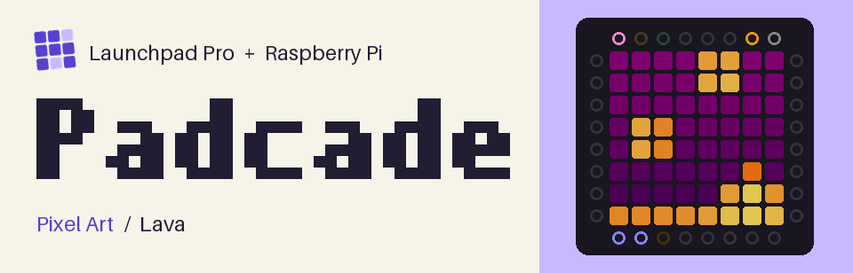
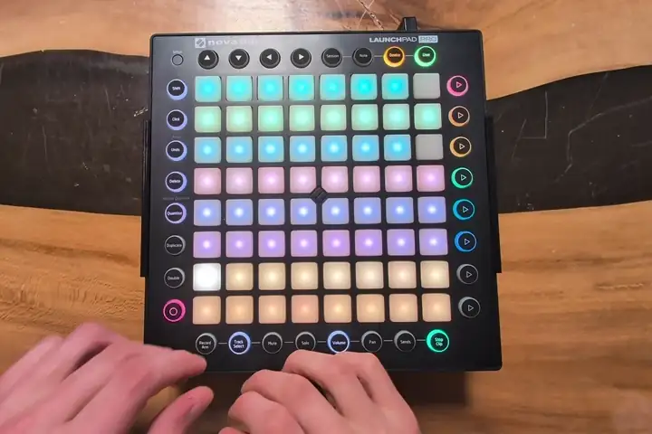
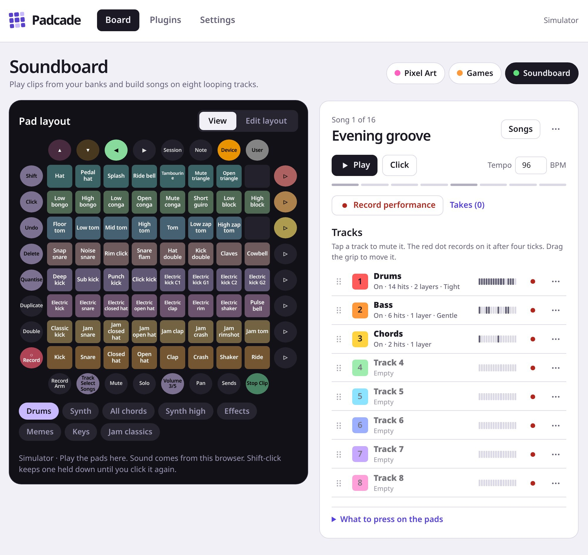
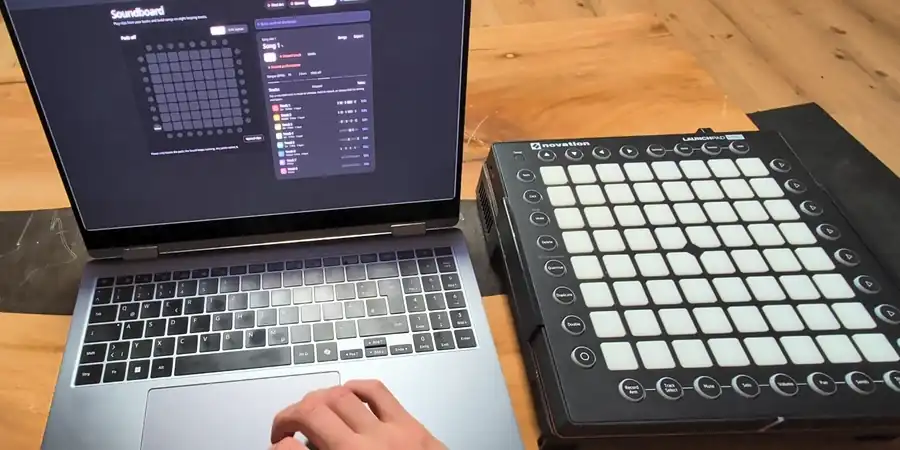
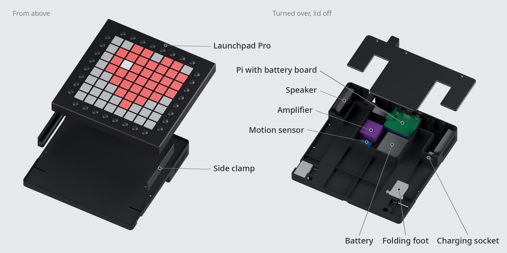
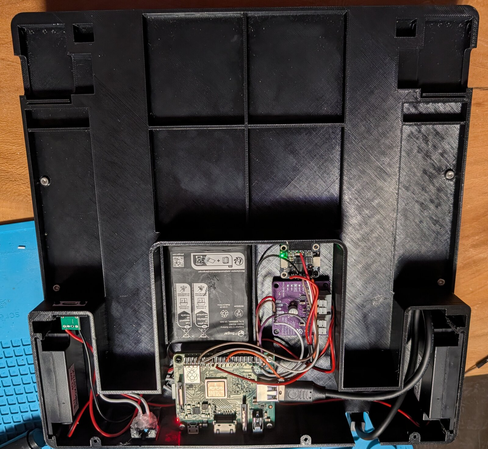
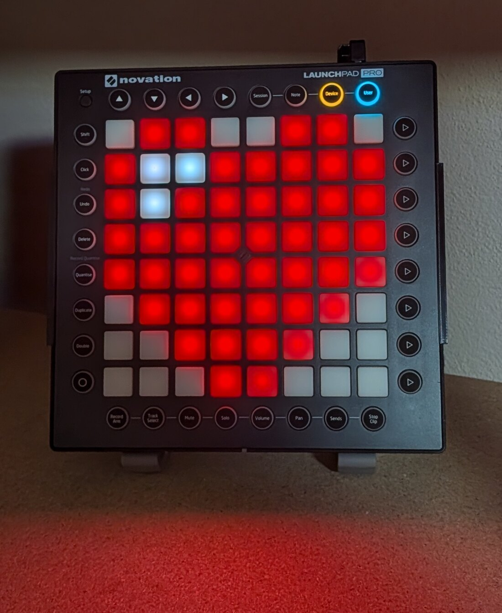

<h1 align="center"></h1>

<p align="center">
  <a href="#try-it-in-your-browser"><strong>Try the simulator</strong></a> &nbsp;·&nbsp;
  <a href="#plugins">Plugins</a> &nbsp;·&nbsp;
  <a href="#hardware">Hardware</a>
</p>

**Padcade turns a Launchpad Pro into a standalone soundboard, pixel art display and games console.** A Raspberry Pi, a battery and two speakers sit in a printed case under the Launchpad, so it runs on its own with no computer attached. A web page on the Pi shows the pads live and is where you set everything up.



- **Soundboard.** Eight different sound banks and an eight-track looper. Record, layer and export your songs.
- **Pixel Art.** Animated scenes and your own drawings.
- **Games.** Mines, Duel, Moles, All off, Sand and Marble Maze. Two of them are played by tilting the board.
- **Home Assistant.** Lights, scenes and scripts on the pads.
- **Plugins.** Everything above is a plugin, and new ones can be uploaded directly in the web UI.

<br clear="both">

## Try it in your browser

The whole board runs as a simulator. You need Python 3.11 or newer and nothing else.

```sh
git clone https://github.com/latentgrid/padcade
cd padcade
python3 -m padcade --simulator
```

Open [localhost:8080](http://localhost:8080/), choose **Soundboard** and click the pads. To record a loop, press the red dot beside a track, wait for the four clicks and play.

<p align="center"><a href="docs/simulator.jpg"></a></p>

With a real board, the page and the pads stay in sync. The page shows what the pads show, and a track muted on the board is muted in the browser’s track list.

<p align="center"></p>

## Plugins

Every page, game and scene is a plugin: a folder with two files. A plugin returns 64 colours for the pads and is told when a pad is pressed. This one makes pads glow where you tap them:

```toml
# glow/plugin.toml
name = "Glow"
kind = "scene"
api = 2
version = "0.1.0"
colour = "#00c2ff"
about = "Pads light up where you tap, then fade."
```

```python
# glow/plugin.py
class Plugin:
    def __init__(self, board):
        self.tapped = {}                     # pad -> when it was last tapped

    def press(self, x, y, velocity, now):    # x and y count from the bottom left
        self.tapped[8 * y + x] = now

    def frame(self, now):                    # 64 colours, asked for 50 times a second
        glow = [max(0, 1 - (now - self.tapped.get(pad, -9)) / 2) for pad in range(64)]
        return [(0, int(190 * g), int(255 * g)) for g in glow]
```

Zip the folder and add it on the **Plugins** screen. It works the same in the simulator and on the board. If a plugin crashes, it is stopped and the rest keeps running.

The built-in plugins in [`padcade/plugins`](padcade/plugins) are examples to copy. The [plugin guide](docs/plugins.md) has the full interface.

## Hardware

<a href="docs/case.jpg"></a>

A Launchpad Pro (2015) and a Raspberry Pi 3A+ with a battery board, an amplifier with two speakers and a motion sensor, in a printed case with folding feet. The speakers, the sensor and the battery are optional.

<a href="docs/build/case-open.jpg"></a>
<a href="docs/build/standing.jpg"></a>

The photos show case V19. The files here are V20, which fixes its fit problems and has not been printed yet.

[Parts and wiring](docs/build.md) · [Print the case](case/README.md)

### Install on a fresh Pi

1. Put **Raspberry Pi OS Lite 12 or newer** on a card with [Raspberry Pi Imager](https://www.raspberrypi.com/documentation/computers/getting-started.html). Set a username, a hostname and your Wi-Fi, and enable SSH.
2. Boot the Pi, plug in the Launchpad and log in with the username and hostname you set.

   ```sh
   ssh <user>@<hostname>.local
   ```

3. Download Padcade and run the installer. It asks which parts you fitted.

   ```sh
   curl -L https://github.com/latentgrid/padcade/archive/main.tar.gz | tar -xz
   sudo ./padcade-main/install.sh

   sudo reboot
   ```

After the restart, choose **Soundboard** on the Launchpad and tap the bottom-left pad to hear a kick drum.

The board’s page is at `http://<hostname>.local/`. Anyone on your network can open it, play and manage the board, plugins included, until you set a password in **Settings**. A password can lock the whole page or only the managing.

## More

[Record a song](docs/soundboard.md) · [Make a sound bank](docs/sound-banks.md) · [Write a plugin](docs/plugins.md) · [Troubleshooting](docs/maintenance.md)

Software: GPL-3.0-or-later · Case, docs and pictures: CC BY-NC-SA 4.0 · Factory sounds: CC0 · [Licences and credits](docs/licences.md) · [Contributing](CONTRIBUTING.md)

Want to sell the case, or use Padcade under other terms? Open an issue to get in touch.
