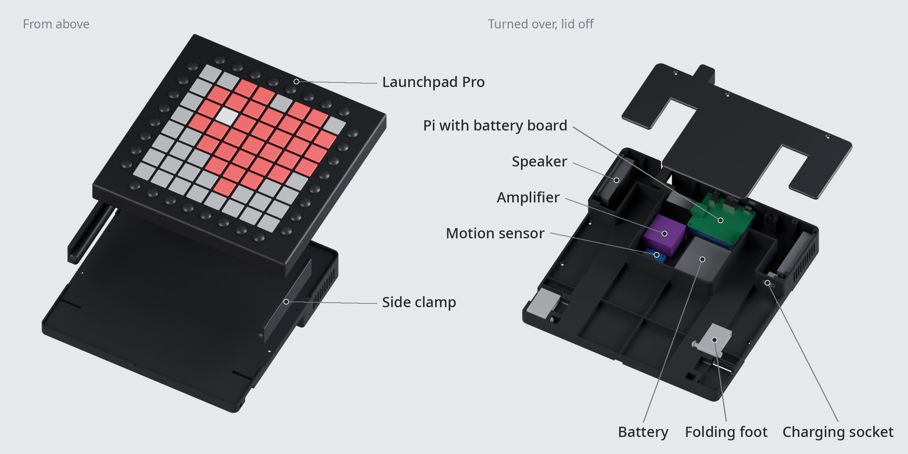
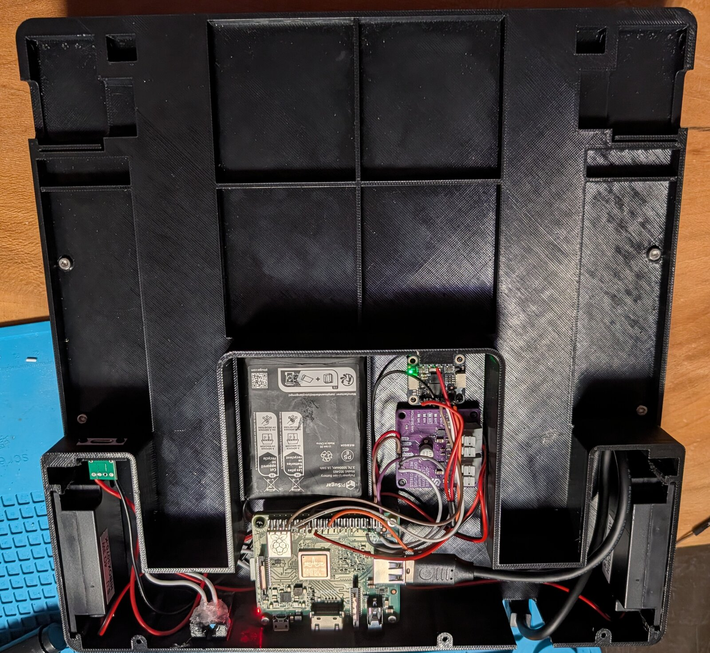
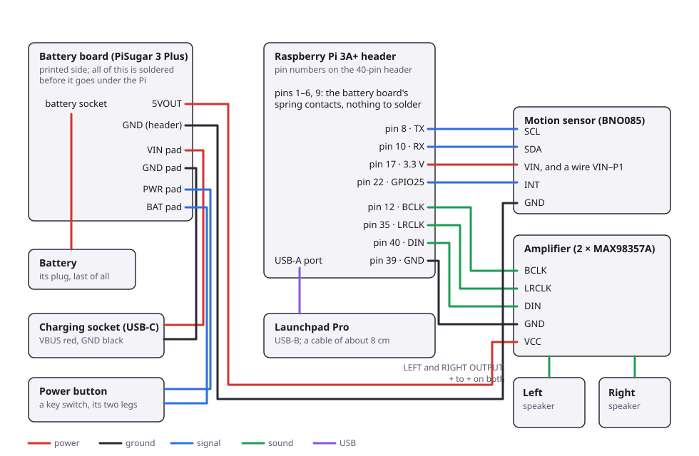
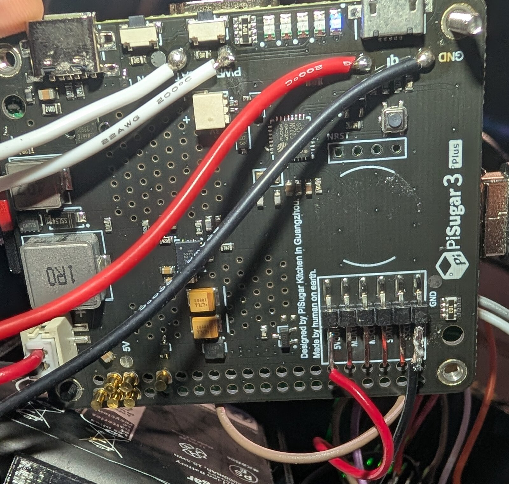
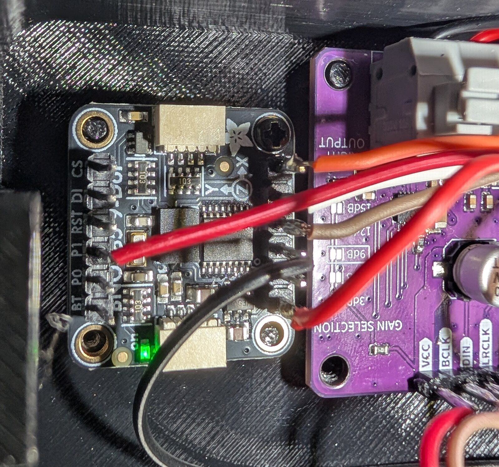
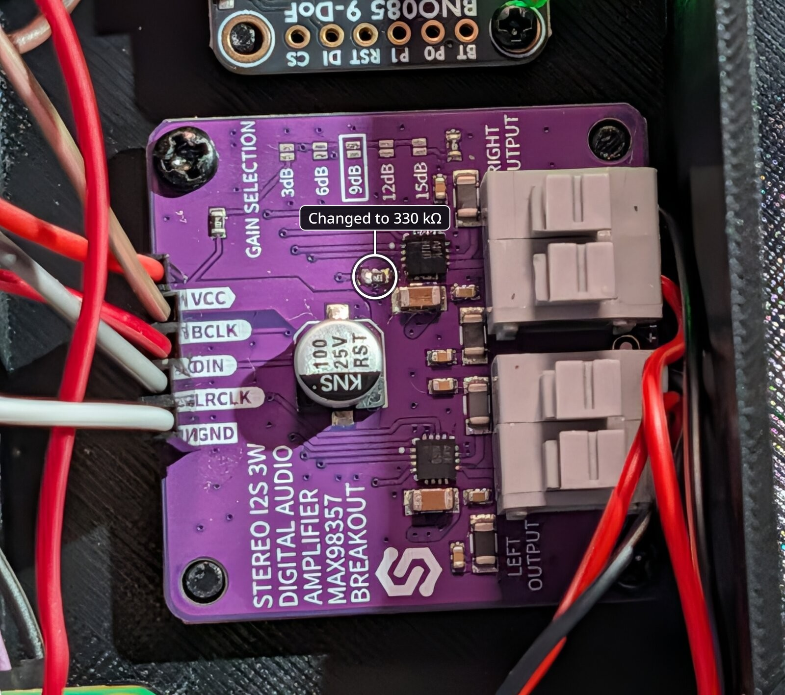
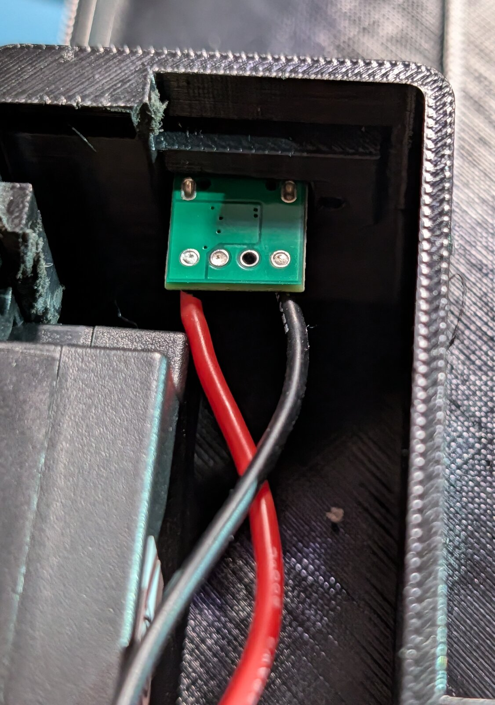
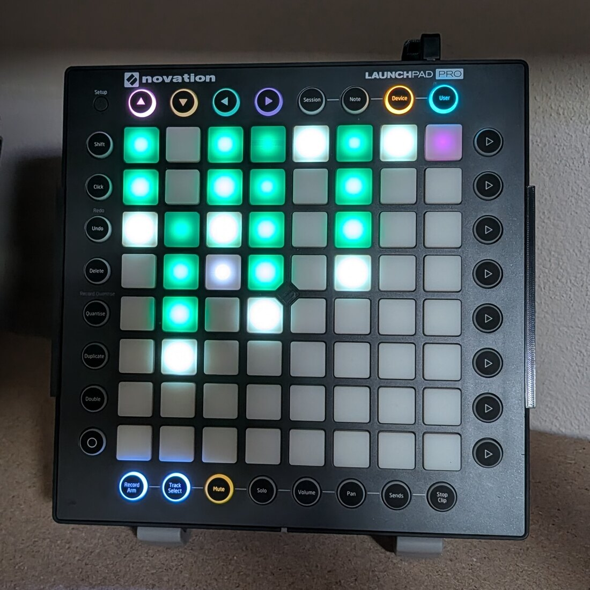

# Building one

What it takes to build the board shown in the pictures: the parts, the wiring and the order to put it together. The software side is in the [README](../README.md), the printed case in [case/](../case/README.md).

The drawing shows V20; the photos are from the V19 case. The steps below are for V20, which fixes what did not fit in V19 but has not
been printed yet.

## Parts

| Part | Exactly | Notes |
|---|---|---|
| Pad controller | Novation Launchpad Pro (2015; the Pro of the MK2 generation, often sold as "Launchpad Pro MK2"; not the Launchpad Pro MK3 of 2020) | over USB it calls itself "Launchpad Pro"; the software speaks this model's protocol only |
| Computer | Raspberry Pi 3 Model A+ | the case is drawn for its connectors |
| microSD card | any microSD card of 8 GB or more | for Raspberry Pi OS Lite |
| Battery board | [PiSugar 3 Plus with its 5000 mAh cell](https://www.amazon.de/dp/B09QRS666Y) | sits under the Pi on spring contacts |
| Amplifier | [Soldered "Stereo I2S audio amplifier MAX98357"](https://soldered.com/products/stereo-i2s-audio-amplifier-max98357) (product 333355): two MAX98357A | see the note on its pull-up below |
| Speakers | two [Adafruit 3351, mono enclosed speaker, 3 W, 4 Ω](https://www.berrybase.at/mono-gehaeuselautsprecher-3w-4-ohm), 30 × 70 × 17 mm, JST-PH lead | they slide into rails |
| Motion sensor | [Adafruit 9-DOF orientation IMU fusion breakout, BNO085](https://www.berrybase.at/adafruit-9-dof-orientation-imu-fusion-breakout-bno085-bno080) | used over UART, not I2C |
| Charging socket | [RUNCCI-YUN USB-C female panel-mount socket](https://www.amazon.de/dp/B0F1MJVBT7) on a small board with screw holes (a pack of 20) | |
| Power button | [key switch KHT36PV5](https://www.berrybase.at/kurzhubtaster-vertikale-printmontage-3-5x6mm-h-5-0mm), 3.5 × 6 mm, 5.0 mm high | pressed by a printed tab; the case's pocket is drawn for this switch |
| USB cable | [LANMINGLEL short USB 2.0 cable, A to angled B](https://www.amazon.de/dp/B0D9RRQXFW), the "down and up" variant, shortened to about 8 cm between the plugs | Pi to Launchpad, inside the case |
| Screws | 3 × M2.5 × 12 · 7 × M3 × 8 countersunk · 2 × M3 × 5 self-tapping · 4 × M2 × 5 self-tapping | Pi stack · clamps (4) and lid (3) · amplifier · sensor (2) and charging socket (2) |
| Inserts | 4 × M3 brass heat-set inserts, 5 mm outer diameter, 4 mm long | in the clamps |
| Buffers | 6 adhesive rubber buffers, 8 × 2 mm | under the lid |
| Wire | 22 AWG, soldered at both ends; heat-shrink for the charging wires | no jumper cables inside the case |
| Printed case | every file in [case/v20](../case/README.md) | the shell needs a print bed of 270 mm or more |

Tools: a soldering iron (with an insert tip for the clamps), wire stripper and side cutter, a heat gun,
screwdrivers, and a multimeter.

## Wiring

**Battery board (PiSugar 3 Plus).** Everything is soldered to its printed side before it goes under the Pi: in the
case that side faces the plate and cannot be reached later.

| From | To | Wire |
|---|---|---|
| battery socket | the battery's plug | plugged in last, at the test |
| 5VOUT on the extension header | amplifier VCC | 22 AWG, about 15 cm |
| GND on the extension header (the last pin) | sensor GND | check that pin against the GND pad with a multimeter first |
| VIN pad | charging socket VBUS | red, about 20 cm |
| GND pad in the corner | charging socket GND | black, about 20 cm |
| PWR pad and BAT pad | the key switch's two legs | about 12 cm |
| spring contacts | Pi pins 1–6 and 9 | nothing to solder |

**Raspberry Pi header** (physical pin numbers).

| Pin | To |
|---|---|
| 8 (GPIO14, TX) | sensor SCL |
| 10 (GPIO15, RX) | sensor SDA |
| 17 (3.3 V) | sensor VIN |
| 22 (GPIO25) | sensor INT |
| 12 (GPIO18) | amplifier BCLK |
| 35 (GPIO19) | amplifier LRCLK |
| 40 (GPIO21) | amplifier DIN |
| 39 (GND) | amplifier GND |

**Motion sensor.** Its wires are soldered straight to the pads on its edge; the two small sockets stay empty. It
runs in its UART mode: solder a short wire between its VIN and P1 pads and leave P0 as it is. Over I2C, next to the battery board, its readings failed.

**Amplifier.** Left speaker to LEFT OUTPUT, right speaker to RIGHT OUTPUT, + to + on both, or the bass cancels.
On this breakout powered from 5 V, both chips played the left channel: the right chip's pull-up on its SD pin had
to be changed from 220 kΩ to 330 kΩ for true stereo (ringed in the picture). If you find the two sides swapped after the lid is on, swap
them in `/etc/asound.conf` with a `route` plug instead of opening the case.

**Charging socket.** If a USB-C to USB-C charger gives nothing but a USB-A charger works, the socket board lacks
the two 5.1 kΩ resistors from CC1 and CC2 to GND.

## Assembly

Fourteen steps: two on the bench, then the shell upside down on a towel, then the Launchpad and the feet.

Before you start: take the supports out of both foot housings and keep their 1 mm slot clear; press the power
button's tab, it should spring back freely; heat-set the four M3 inserts into the clamps; try the lid on and each
speaker in its rails before anything is wired.

1. **Wire the battery board**, as in the table above. Put the switch on its wires first, so no live end hangs loose.
   Then put the battery board on the Pi as its kit does, leaving out the kit's screws on three corners.
2. **Make the USB cable.** Cut it and join it again with about 8 cm between the plugs: red, white, green, black and
   the shield, each joint in heat-shrink, one sleeve over all. Try it on a computer: the Launchpad should show up.
3. **Slide the speakers in.** Each one down into the rails on its side wall, cone toward the grill, until it stops
   at the plate. Mark the + wires. Lay the left lead flat on the plate toward the middle; the Pi goes over it.
4. **Put the battery and the Pi in.** The battery into its pocket, lead at the back left corner, still unplugged.
   The Pi and battery board onto the three posts against the back wall, battery board down, with the three
   M2.5 × 12 through both boards. Snug: the posts are plastic. Drop the key switch into its pocket behind the back
   wall, plunger toward the wall.
5. **Fit the charging socket.** Push its two wires out through the opening in the front wall of the left side
   section, solder them to the socket board outside the case (red to VBUS, black to GND, heat-shrink both), push
   the board back in and screw it with two M2 × 5.
6. **Fit the amplifier and the sensor.** Solder the amplifier's five wires first. Set it on its posts beside the
   battery, outputs toward the back wall, two M3 × 5. Set the sensor on its posts at the front, parts toward the
   plate, two M2 × 5. Solder the sensor's wires as in the tables: GND from the battery board, the other four to the Pi header.
7. **Wire the amplifier** to the Pi header at the pin tips, wires led off flat, and push the speaker leads into its
   terminals.
8. **Lay the USB cable.** A plug into the Pi, the cable along the back to the opening in the back wall, B end
   hanging out.
9. **Test.** Plug the battery in. Switch on with the rear button: click, then hold until the battery board's LEDs
   count up. Check that the Pi boots, the charging socket charges, the motion sensor reports and a clip plays,
   before the lid goes on.
10. **Close the lid.** Lower it straight on about 2.5 mm behind its place, then slide it forward so its three
    tongues go into the slots in the front walls. Three M3 × 8 along the back. Stick on the six buffers.
11. **Put the Launchpad on.** Turn the case over, set the Launchpad into its rim, slide each clamp in from the side
    (its foot into the Launchpad's side notch, its hook over the top edge) and fix it with two M3 × 8 from below.
12. **Plug in the USB-B** and press its cable down into the trough.
13. **Fit the feet.** Each into its pocket, its pivot pin in from outside, then the clip up from underneath into
    the pin's groove.
14. **Stand it on its feet.** The two channels under the case leave room for the arms of a stand, if you use one.

## Found out the hard way

- The BNO085 only works reliably over UART (SHTP at 3 Mbaud). On I2C next to the battery board its readings fail.
- All clips are mixed into one stream. One player process per note crackles when four notes sound at once.
- The mixer writes 256-frame periods (5.8 ms at 44.1 kHz) on this build. Four periods of buffer give the Pi time to feed the amplifier while the pads and browser are busy. The mixer estimates the combined level of active notes when a voice starts or ends. It accounts for fading tails and limits peaks within the audio it has already buffered.
- The battery board's bus drops a reading now and then, so one or two missing readings in a row are bridged.
- Every USB connection has to put the Launchpad in Standalone and then Programmer mode.
- The motion sensor's idea of "level" is a little off in every build. Put what it reads with the board flat on a
  table in `config.toml` as `tabletop_gravity = [x, y, z]`, and the tilt games start level even when opened tilted
  (without it they take the angle they are opened at as level).
